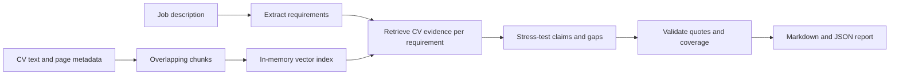

# CV Stress Test — LangGraph + RAG

Stress-test **your own CV** against a target job description. The output highlights
direct evidence, vague claims, and requirements not found in retrieved CV passages,
with source quotes, probing interview questions, and actionable editing suggestions.

This is a local Python project with a browser UI and command-line interface. It does not make hiring decisions,
rank people, or estimate an employer's ATS score or your chance of getting hired.

## Try the browser UI

From this repository:

```sh
python3 -m venv .venv
source .venv/bin/activate
python -m pip install -e '.[dev]'
streamlit run streamlit_app.py
```

Open http://localhost:8501. Click **Load sample CV & job**, then **Stress-test my CV**
for a free offline demonstration. For your own review, paste or upload your CV,
paste a target job description, and select **AI assessment** in the sidebar.
Enter your API key there or set `OPENAI_API_KEY` before launching.

The UI shows findings, source quotes, interview questions and editing suggestions,
with Markdown and JSON downloads. Changing an input clears the old result.
Uploaded files are parsed in a temporary folder and removed after reading; reports
are held in session memory until you download them. The server binds to your own
computer only. This prototype has no authentication and should not be exposed publicly.

## Quick start

Requires Python 3.11 or newer. Run these commands from this project folder:

```sh
python3 -m venv .venv
source .venv/bin/activate
python -m pip install -e '.[dev]'

cv-stress-test --demo --cv examples/cv.md --job examples/job.md --out outputs/demo.md
```

Open `outputs/demo.md` for feedback and `outputs/demo.json` for the complete evidence
trail. Outputs are never silently overwritten; choose another filename for each run.

**Demo mode is a deterministic smoke test.** It uses hashed keyword vectors and
simple overlap matching, not an LLM or semantic embeddings. It cannot meaningfully
judge your CV. Job descriptions can be plain text, numbered lists, or bullet lists.
Demo mode checks up to 12 distinct sentences or lines, skipping Markdown headings
and section labels ending in a colon. It does not semantically identify requirements.

## Stress-test your actual CV

Put your CV and a real job description in `private/` (ignored by Git). Supported inputs:
UTF-8 `.txt`, `.md`, and text-based `.pdf`. Scanned PDFs need OCR first. No DOCX support.

Set your API key in your terminal, not in source code or chat:

```sh
export OPENAI_API_KEY='your-key'
export CV_MODEL='gpt-4.1-mini'
export CV_EMBEDDING_MODEL='text-embedding-3-small'

cv-stress-test --cv private/my-cv.pdf --job private/target-job.txt --out outputs/my-review.md
```

Choose model names available to your API account. The chat model must support
structured output. `.env.example` documents the variables; `.env` is not loaded automatically.

Live mode sends CV chunks to the embedding provider and retrieved CV passages plus
the job description to the chat provider. Remove contact details or other information
you do not want sent. The vector index exists only in memory for that run, but the
local JSON report includes retrieved CV text and the job description. Treat both
reports as private. This app adds no telemetry; if you enable LangSmith tracing in
your environment, that service may also receive workflow data.

Run multiple CV versions against the same job using distinct output names to compare
the evidence and wording. Review suggestions before adopting them; fill placeholders
only with facts you can substantiate.

## How LangGraph and RAG are used



`workflow.py` compiles four LangGraph nodes: requirement extraction, retrieval,
assessment, and validation/reporting. LangGraph passes typed state between them.
RAG retrieves up to four CV chunks for each of at most twelve explicit job requirements.
Live mode uses OpenAI embeddings through LangChain's `InMemoryVectorStore`, then
structured model output for the assessment. The documents themselves are the evidence
corpus; there is no invented recruiter knowledge base or external candidate database.

The validator requires one finding per extracted requirement, checks each job quote
against the original description, and checks every CV quote against the retrieved
chunk assigned to that requirement. Invalid responses fail instead of generating a
misleading report. Source matching verifies quotations, **not the truth or relevance
of the model's interpretation**. The prompts treat document instructions as untrusted
and prohibit invented experience and protected-trait judgments; these prompt rules
are not a complete defense against adversarial documents.

## Tests

```sh
python -m pytest -q
```

Tests cover the complete offline graph, the live branch with a stub model, source
metadata, empty inputs, invalid quotes, missing/duplicate findings, and CLI output
preservation, UI demo flow, input errors, and clearing stale results. They do not call a paid model API.

## Scope and limits

- Prototype for personal coaching: local browser UI, no accounts, database, or hosted deployment.
- Semantic live retrieval and assessment need API access and incur provider charges.
- Retrieval can miss relevant evidence; `not_found` never means you lack a skill.
- Up to twelve extracted requirements: not a guarantee of exhaustive job coverage.
- PDF text order and multi-column layout can affect results. Review extracted evidence.
- File limit: 10 MB and 100,000 extracted characters per input.
- Chunking is character-based with overlap; no OCR, layout evaluation, or calibrated benchmark.
- Models can still misinterpret evidence or suggest unsupported edits. Review every finding.

## Official references

- [LangGraph graph API](https://docs.langchain.com/oss/python/langgraph/graph-api)
- [LangChain in-memory vector store](https://reference.langchain.com/python/langchain-core/vectorstores/in_memory/InMemoryVectorStore)
- [ChatOpenAI integration and structured output](https://docs.langchain.com/oss/python/integrations/chat/openai)
